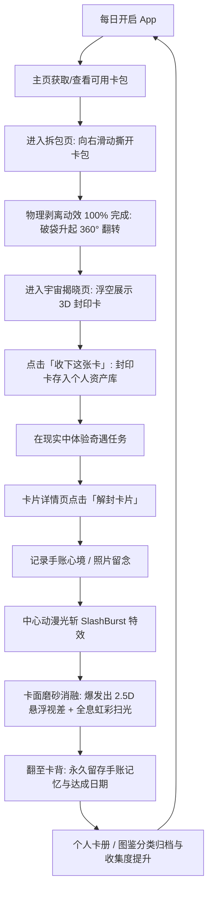

# LIFE PACK / Life Peak 综合产品与技术架构文档 (Product & Technical Specification)

> **文档版本**：v1.0.0  
> **文档定位**：全功能产品设计说明书、3D全息渲染技术规范与使用指南（专为产品团队、技术团队及 AI 产品分析专家打造）  
> **关联仓库**：[https://github.com/ashlandy79/life-peak](https://github.com/ashlandy79/life-peak)  
> **涵盖工程**：
> - `mobile/`：基于 Expo SDK 52 / React Native 的移动客户端（iOS / Android / Web）
> - `managment/`：基于 Vite / React 18 / Tailwind CSS / Express 的官方数字资产生产台与闪卡工坊

---

## 目录 (Table of Contents)

1. [项目愿景与产品定位 (Product Vision & Core Value)](#1-项目愿景与产品定位)
2. [用户画像与核心使用场景 (User Persona & Scenarios)](#2-用户画像与核心使用场景)
3. [核心业务闭环与用户旅程 (Core Loop & User Journey)](#3-核心业务闭环与用户旅程)
4. [双端系统架构概览 (System Architecture)](#4-双端系统架构概览)
5. [功能模块详细设计 (Functional Modules Breakdown)](#5-功能模块详细设计)
   - 5.1 移动端 (`mobile`) 核心模块
   - 5.2 资产工坊端 (`managment`) 核心模块
6. [3D全息渲染管线与视觉物理实现 (3D Rendering Pipeline)](#6-3d全息渲染管线与视觉物理实现)
   - 6.1 Three.js 物理卡包贝塞尔连续撕裂模拟
   - 6.2 原生 WebGL 双通道 HDR Bloom & 黄金角磨砂着色器
   - 6.3 封印状态（Sealed）vs 解封状态（Unsealed）1:1 视觉映射
   - 6.4 宇宙揭晓页 (Cosmic Reveal Stage) 与 React Bits 特效系统
7. [数据模型与核心契约 (Data Models & Schemas)](#7-数据模型与核心契约)
8. [环境要求、安装与操作说明 (Deployment & Usage Guide)](#8-环境要求安装与操作说明)
9. [供产品AI分析优化的维度与未来演进路线 (Product Evaluation & Roadmap)](#9-供产品ai分析优化的维度与未来演进路线)

---

## 1. 项目愿景与产品定位

### 1.1 背景与核心痛点
- **生活仪式感缺失**：现代年轻人在快节奏生活中常感到单调，传统待办事项（To-Do List）或习惯打卡工具过于严肃功利，容易产生挫败感与倦怠。
- **数字藏品无实体温度**：常见的数字卡牌/NFT往往只是一张扁平图片或循环播放的简单动画，缺乏实体集换式卡牌（TCG，如宝可梦、万智牌）的物理拆包快感、微距光栅反射以及触手可及的收藏重量感。

### 1.2 产品定位 (Value Proposition)
**LIFE PACK (Life Peak)** 是一款 **“把日常生活小事变成具有仪式感与珍藏价值的 3D 全息奇遇闪卡”** 的生活探险与手账卡牌应用。

- **核心主张**：*“一张卡，就是一次小小的出发。”*
- **三大产品支柱**：
  1. **物理触感拆包**：1:1 还原真实铝箔卡包向右撕裂、侧边剥离滑落与卡牌破袋升起的沉浸感。
  2. **封印与解封契约**：抽出的卡片初始为“封印态（低饱和深墨黑、黄金角磨砂、LIFE SEAL 罗盘印章）”，引导用户前往现实生活完成微小的奇遇任务（如“去便利店买一瓶没喝过的饮料”），记录手账感想后通过光斩动画“解封”，瞬间迸发出全光谱彩虹扫光、2.5D 突破卡框的浮雕视差与 HDR 辉光。
  3. **手账与记忆沉淀**：每张卡片正面是极具收藏价值的高精度全息原画，背面则是温润纯粹的手账留白，记录用户真实的完成瞬间与情绪记忆。

---

## 2. 用户画像与核心使用场景

| 维度 | 特征与场景描述 |
| :--- | :--- |
| **核心客群** | 18~32 岁年轻都市群体、Z 世代、手账爱好者、二次元/TCG实体卡牌收集者、Citywalk探险者 |
| **典型心理** | 喜欢生活中的小确幸、注重开箱/拆包即时反馈、喜欢拍照分享独特视觉、追求个性化数字藏品 |
| **主要场景 A：晨间/下班通勤抽包** | 用户在通勤路上打开 App，向右滑动撕开每日奇遇卡包，抽到一张封印的 `#027 奇遇特饮` 任务卡。 |
| **主要场景 B：现实体验与解封** | 用户按卡片提示走进便利店不看配料表选了一瓶饮料。喝完后点击“解封”，写下此刻心情，卡片金光四射解封，永久存入卡册。 |
| **主要场景 C：闲暇翻赏与3D互动** | 睡前打开个人卡册，手指在屏幕上拖拽旋转卡片，观察全息双层边框的彩虹折射、倾角流光与卡背手账笔记。 |

---

## 3. 核心业务闭环与用户旅程



---

## 4. 双端系统架构概览

```
life-peak/
├── mobile/                      # [客户端] 移动端跨平台应用 (Expo SDK 52)
│   ├── src/
│   │   ├── app/                 # 基于 Expo Router 的文件路由系统
│   │   │   ├── (tabs)/          # 底部四大主页: 首页、卡册、任务、个人
│   │   │   ├── pack/opening.tsx # 3D 卡包撕裂与宇宙揭晓全流程
│   │   │   ├── card/[instanceId]# 3D 卡片交互、翻转、解封全流程
│   │   │   └── memory/[id].tsx  # 手账心得与记忆撰写编辑
│   │   ├── components/          # UI 业务与特效组件
│   │   │   ├── TcgHoloCard.tsx  # 原生 WebGL 全息卡片 React 容器
│   │   │   ├── ThreePackStage   # Three.js 物理卡包网格剥离舞台
│   │   │   ├── cosmic/          # 揭晓页空间系统 (粒子、棱镜光束、能量环、珍珠按钮)
│   │   │   └── SlashBurstEffect # 解封中心动漫光斩特效
│   │   ├── core/                # 核心图形学与渲染管线底层
│   │   │   ├── tcgHoloRenderer  # WebGL2 双通道 HDR Bloom & 黄金角磨砂着色器
│   │   │   ├── threePackRenderer# Three.js 细分网格贝塞尔弯曲卡包渲染器
│   │   │   ├── tcgParameters.ts # 材质参数预设与稀有度模组体系
│   │   │   └── tcgTypes.ts      # 核心全息与业务类型定义
│   │   ├── services/            # 数据仓库与本地状态持久化
│   │   └── utils/               # Canvas 2D LIFE SEAL 矢量卡面渲染器
│   └── assets/                  # 离线环境与默认卡片材质切片
│
├── managment/                   # [管理端] 官方卡片制作台与数字工坊 (Vite + React 18)
│   ├── src/
│   │   ├── components/views/    # 工作台各主视图 (Dashboard, CardStudio, PackStudio, TemplateStudio)
│   │   ├── core/                # 共享 WebGL2 光学着色器与物理撕包内核
│   │   ├── services/api.ts      # 与 Express 后端通信的 REST 接口服务
│   │   └── utils/               # 图像解析、Alpha 通道探测、ZIP 打包导出
│   └── data/                    # 本地文件存储与持久化 (db.json, uploads/)
│
└── docs/                        # 项目产品与技术规格书沉淀
```

---

## 5. 功能模块详细设计

### 5.1 移动端 (`mobile`) 核心模块

| 模块名称 | 路由路径 | 核心业务功能与交互亮点 |
| :--- | :--- | :--- |
| **生活主页 (Home)** | `/(tabs)/index` | - 顶部品牌标题、日期与当前任务提示<br>- 卡包状态与「今日卡包」快捷入口<br>- 每日微奇遇任务面板 (`DailyTasksPanel`)<br>- 解谜拼图与收集进度预览 |
| **卡包撕开页 (Pack Opening)** | `/pack/opening` | - **阶段1（撕裂）**：静置视角 Three.js 卡包，手指按住卡包向右滑动触发连续贝塞尔剥离，根据撕开百分比动态反弹或断裂。<br>- **阶段2（破袋）**：封口脱落，卡包滑落，内部卡片升起并完成 360° 旋转。<br>- **阶段3（宇宙揭晓）**：无缝淡入对角线虹彩棱镜光束、漂浮星尘晶体与地面椭圆能量环，展示悬浮 3D 全息卡片。<br>- **阶段4（收下卡片）**：点击「收下这张卡 →」或「查看卡册」完成卡片持久化存储并流转。 |
| **卡片详情页 (Card Detail)** | `/card/[instanceId]` | - **封印态 3D 呈现**：默认珍珠蓝（`pearl-blue`），深墨黑曜石压暗与微表面磨砂，居中显示罗盘印章。<br>- **3D 手势交互**：按住卡片自由倾角旋转，全息折射光斑实时随视角位移；轻触卡片或点击下方按钮翻转 180° 查看卡背手账。<br>- **解封交互**：点击「解封卡片」呼出确认弹窗，播放屏幕中心光斩动效，磨砂消融，卡片爆发出 2.5D 悬浮与全光谱彩虹超频发光。 |
| **卡片资产库 (Album)** | `/(tabs)/album` | - 网格展示已获得的全部卡片，支持按分类（食物、出行、社交、夜间、自我、情绪）筛选。<br>- 区分“已封印”、“进行中”、“已完成”标签与星级徽章。<br>- 收藏夹标记与快捷检索。 |
| **手账记录 (Memory)** | `/memory/[instanceId]` | - 记录奇遇任务执行时的真实感悟、心情标签。<br>- 支持从本地相册上传配图并永久保存在卡片背面。 |

### 5.2 资产工坊端 (`managment`) 核心模块

| 模块名称 | 对应视图 | 核心业务功能 |
| :--- | :--- | :--- |
| **仪表盘 (Dashboard)** | `DashboardView.tsx` | 统计全库卡片总数、卡包总数、模组就绪数，以及草稿与待导出资产流转状态。 |
| **卡片资产库与制作台** | `CardStudioView.tsx` | - 极简图层装配：仅需上传核心透明主体 (`subject.png`) 与背景底图 (`background.png`)，自动校验透明度。<br>- 一键绑定等级模组，自动继承边框调色与光学参数。<br>- 封印态与解封态实时预览与 2D/3D 原画切片截取。 |
| **数字卡包工坊** | `DigitalPackStudioView.tsx` | - 三维卡包正面贴图、侧边厚度材质、背面纹理与撕裂条装配。<br>- 卡包卡池编组与封面主打卡绑定。<br>- 一键导出符合分发规范的标准 ZIP 包（包含 `pack_manifest.json` 与所有切片）。 |
| **卡片模板与模组中心** | `CardTemplateLibraryView.tsx` | - 普通/高级/稀有及自定义等级管理。<br>- 程序化矢量边框调色 vs 自定义边框切片双模态支持。<br>- 6 种光学蒙版与 3 种专属结构光参数微调。 |

---

## 6. 3D全息渲染管线与视觉物理实现

### 6.1 Three.js 物理卡包贝塞尔连续撕裂模拟
- **几何网格划分**：卡包封口撕裂条采用细分平面的 `PlaneGeometry(w, h, 64, 16)` 顶点网格。
- **贝塞尔弯曲变形**：用户向右滑动时，顶点着色器根据沿 X 轴的撕开进度进度值 $t \in [0, 1]$ 动态计算三次贝塞尔曲线方程，实现封条向外自然卷曲、受拉伸剥离的物理弯曲形变。
- **阶段性物理反馈**：
  - 进度 $< 100\%$ 释放手指：带有弹性阻尼动画自动回弹并重置。
  - 进度 $\ge 100\%$：触发封口碎片飞散，卡包主体受重力向下滑落，内部卡片伴随缓动方程以 360° 自转姿态破袋升起。

### 6.2 原生 WebGL 双通道 HDR Bloom & 黄金角磨砂着色器
在 [`tcgHoloRenderer.ts`](file:///d:/myProject/抽卡项目/mobile/src/core/tcgHoloRenderer.ts) 中，不依赖臃肿的外部引擎，直接使用纯原生 WebGL 高性能着色器管线：

1. **黄金角螺旋磨砂采样 (Golden-Angle Frosted Blur)**：
   利用黄金分割角 $\theta \approx 2.39996323\text{ rad}$ 进行 6 点等权螺旋分布采样，产生无规律自然磨砂质感；并引入牢固贴合卡面的表面微晶微粒（Surface Micro-Grain），视角倾斜时磨砂层牢牢固定在卡面坐标上，消除传统分离滤镜的“漂浮脱落感”。
2. **多光谱虹彩干涉光束 (Holo Rainbow Interferometry)**：
   $$spectrum = 0.52 + 0.48 \cdot \cos(2\pi \cdot (phase + [0.0, 0.33, 0.67]))$$
   光束根据视角向量 $view = (\sin(degY) \cdot 0.65, \sin(degX) \cdot 0.65)$ 在卡面以斜向掠射角实时扫过。
3. **双通道 4-Pass 离屏高斯模糊与 HDR 辉光 (Dual-Pass Bloom)**：
   - Pass 1：提取超过阈值的结构线高光并编码为 RGBM 格式写入 1/2 分辨率 FBO。
   - Pass 2~5：执行水平与垂直双尺度近距/宽幅高斯模糊。
   - Pass 6：主屏色调映射合成，产生高达 42× 真实超频泛光。

### 6.3 封印状态（Sealed）vs 解封状态（Unsealed）1:1 视觉映射

| 特征维度 | 未解封状态 (Sealed) | 解封状态 (Unsealed) |
| :--- | :--- | :--- |
| **景深深度 (`depth`)** | `0.0`（纯平立体视差锁定） | `0.85`（2.5D 浮雕视差，角色突破卡框悬浮） |
| **磨砂噪点 (`frostedBlur`)** | `0.65`（深色黑曜石覆盖压暗，画面隐约半透可见） | `0.0`（原画彻底通透纯净） |
| **全息虹彩总强度 (`power`)** | `0.0`（关闭虹彩扫光） | `1.05`（全光谱虹彩扫光全力流转） |
| **结构线发光 (`contour`)** | `0.0`（无边缘自发光） | `0.28` ~ `0.45`（按等级呈现专属光效） |
| **稀有度结构光 (`lightMode`)** | 抑制关闭 | - **稀有 (Rare)**：全息全光谱彩虹光束<br>- **高级 (Advanced)**：暖金丁达尔圣光斜向光束<br>- **普通 (Common)**：低调微弱白暖日光线 |
| **Canvas 矢量印章** | 居中绘制 **LIFE SEAL 罗盘封印印章** | 移除中央印章，呈现完整主体立绘 |
| **底部扇形徽章** | 显示**「已封印」**与暗夜护盾图标 | 切换为**「已兑现」**与闪亮星芒图标 |

### 6.4 宇宙揭晓页 (Cosmic Reveal Stage) 与 React Bits 特效系统
在卡包撕裂完成并破袋后，揭晓页应用了 4 个定制化动效系统：
1. **`CosmicParticles` (参考 React Bits Particles)**：高性能 Canvas 2D 粒子系统，绘制深浅景深的星尘粒子与具有 4 尖角光芒的多面菱形晶体（Diamond Stars），缓慢上升漂移并不规则微闪烁。
2. **`PrismBeam` (参考 React Bits Aurora / Iridescence)**：屏幕对角线方向缓慢呼吸的宽幅体积彩虹棱镜光带，为背景赋予深邃神秘的宇宙氛围。
3. **`GroundEnergyRing`**：卡片正下方投影的双层椭圆流光能量环，外环带珍珠蓝至暖金色散边缘，提供神圣的着陆悬浮感。
4. **`ShinyPillButton` (参考 React Bits ShinyText)**：主操作按钮「收下这张卡 →」覆盖持续滚动的镜面流光扫光（Shimmer Sweep），两侧搭配伴生四角星芒。

---

## 7. 数据模型与核心契约

### 7.1 卡片定义模型 (`CardDefinition`)
```typescript
export interface CardDefinition {
  id: string;                    // 唯一标识 (如 card-027)
  cardCode: string;              // 业务卡号 (如 #027 或 LP-0027)
  title: string;                 // 卡面主标题 (如: 去楼下便利店，买一瓶你没喝过的饮料。)
  subtitle: string;              // 副标题说明
  seriesId: string;              // 所属内容系列 (如: 街角奇遇系列)
  seriesName: string;            // 系列名称
  quote: string;                 // 治愈系短句 (如: 生活很荒唐，但你可以很酷)
  taskTitle: string;             // 关联任务标题 (如: 今日奇遇 #027)
  taskDescription: string;       // 详细要求 (如: 不准研究配料表)
  taskDurationMinutes?: number;  // 建议耗时 (如: 15分钟)
  tags: string[];                // 标签列表: ['出门', '社交', '荒谬']
  previewImage: any;             // 预览合图
  backgroundImage?: any;         // 环境背景贴图 (background.png)
  subjectImage?: any;            // 透明核心主体贴图 (link_subject.png)
  backLiningImage?: any;         // 卡背内衬图 (card_back.png)
  tier?: 'rare' | 'advanced' | 'common'; // 稀有度等级 (默认 rare)
}
```

### 7.2 用户卡片实例模型 (`UserCardInstance`)
```typescript
export type UserCardStatus = 'SEALED' | 'ACTIVE' | 'COMPLETED' | 'COLLECTED';

export interface UserCardInstance {
  instanceId: string;            // 实例唯一流水号
  cardId: string;                // 关联的 CardDefinition ID
  status: UserCardStatus;        // 状态: 刚抽出封印态(SEALED) -> 解封完成(COMPLETED)
  obtainedAt: string;            // 获得卡片 ISO 时间
  acceptedAt?: string;           // 接受任务时间
  completedAt?: string;          // 解封完成时间
  memoryText?: string;           // 用户在卡背写下的手账记忆
  memoryPhotoUri?: string;       // 用户拍摄并关联的真实相册照片
  isFavorite?: boolean;          // 是否标星收藏
}
```

### 7.3 全息参数契约 (`TcgHoloParameters`)
```typescript
export interface TcgHoloParameters {
  depth: number;                 // 2.5D 正负景深 (-3.0 ~ +3.0)
  contourBrightness: number;     // 结构线 HDR 辉光强度 (0.0 ~ 1.0)
  power: number;                 // 全息虹彩总强度 (0.0 ~ 2.0)
  opticalMask: OpticalMaskType;  // 光学蒙版 (holo-rainbow, sunbeam, prism, etc.)
  maskIntensity: number;         // 蒙版强度
  frostedBlur: number;           // 封印磨砂模糊度 (0.0 ~ 1.5)
  rimColor: RimColorType;        // 流光边框配色 (pearl-blue, gold, silver, etc.)
  structureLightMode: StructureLightMode; // 结构光模式 (subtle-sun, tyndall-gold, holo-rainbow)
  isSealed: boolean;             // 是否处于封印状态
}
```

---

## 8. 环境要求、安装与操作说明

### 8.1 运行环境要求
- **Node.js**：`v18.0.0` 或更高版本（推荐 Node 20 LTS）
- **包管理工具**：`npm` (v9+) 或 `yarn`
- **支持平台**：
  - `mobile`：现代桌面/移动浏览器（Chrome, Safari, Edge, Firefox）、iOS / Android 设备（通过 Expo Go 或原生编译）
  - `managment`：Chrome / Edge / Firefox 现代桌面端（需支持 WebGL2 与 HTML5 Canvas）

### 8.2 快速启动指南

#### A. 移动端 (`mobile`) 启动
```bash
# 1. 进入 mobile 目录
cd mobile

# 2. 安装依赖 (初次运行或更新依赖时)
npm install

# 3. 启动 Expo 开发服务
npm run dev
# 或执行: npx expo start --web
```
- 打开浏览器访问控制台提示的地址（默认 `http://localhost:8081`）。
- **体验流程建议**：
  1. 首页直接点击进入卡包撕开页（`/pack/opening`）。
  2. 手指或鼠标按住卡包向右平滑拉扯，体验 Three.js 连续剥离手感。
  3. 撕开至 100% 后欣赏破袋升起与宇宙揭晓页，拖拽 3D 卡面感受全息微动。
  4. 点击「收下这张卡 →」，进入卡片详情页（`/card/[instanceId]`）。
  5. 点击「解封卡片」撰写测试心得，欣赏光斩动效与解封全光谱虹彩爆发。

#### B. 资产工坊端 (`managment`) 启动
```bash
# 1. 进入 managment 目录
cd managment

# 2. 安装依赖
npm install

# 3. 启动开发服务器与后端 Mock 接口
npm run dev
```
- 打开浏览器访问：`http://localhost:5173`。
- 可在卡片模板库中调试流光边框、在数字卡包工坊组装并导出卡包 ZIP。

#### C. 代码静态检查与构建打包
```bash
# 移动端 TypeScript 静态语法校验
cd mobile && npx tsc --noEmit

# 移动端 Web 静态资源打包导出
cd mobile && npx expo export -p web
```

---

## 9. 供产品AI分析优化的维度与未来演进路线

> **给产品经理 / 产品 AI 的深度输入**：  
> 以下为当前项目技术底座已就绪、适合下一阶段重点进行产品化论证与玩法创新的 5 大方向，供进一步头脑风暴与方案细化。

### 9.1 任务智能生成与动态化 (AI-Driven Life Quests)
- **现状**：任务目前基于本地预设的静态规则库（如便利店买饮料、看一次日落、搭讪流浪猫等）。
- **优化点**：引入生成式 AI（LLM），结合用户当天的**地理位置 (LBS)、天气数据、心率/步数 (HealthKit) 与时间时段**，动态为用户定制具有戏剧冲突或治愈感的一日微奇遇，卡面文字与封面通过工作台模板即时合成。

### 9.2 社交集换与卡牌交换 (Social Trading & Gifting)
- **现状**：当前为单机收藏闭环。
- **优化点**：
  - **面对面碰一碰拆包/交换**：利用 NFC 或局域网多播，两个用户靠近时手机屏幕可呈现“合力撕开双人卡包”。
  - **手账记忆匿名漂流**：用户解封卡片时写下的生活记忆，可选择“匿名漂流”，其他用户在撕包时有极低概率抽到他人写下的真实生活切片（“卡片上的字迹与他人的生活”）。

### 9.3 稀有度数值与碎片解谜玩法 (Gacha Mechanics & Puzzle)
- **现状**：卡片拥有普通/高级/稀有等级，视觉上已有微弱阳光/暖金丁达尔/全息虹彩的梯度。
- **优化点**：
  - 设计保底机制与系列全图鉴成就奖励（如集齐“街角漫游 01~10”解锁动态专属全息动态卡背）。
  - 引入“碎片拼图（Puzzle）”：撕开卡包可能掉落碎片，集齐 4 块拼图才能拼合出完整的封印大卡。

### 9.4 实体联动与硬件交互 (Phygital - Physical + Digital)
- **现状**：工作台支持导出高精度无畸变切片原画与全套 ZIP。
- **优化点**：
  - **实物闪卡打印定制**：支持用户一键下单将自己解封后的卡片制作成真实的镭射烫金实体小卡，邮寄到家。
  - **陀螺仪重力感应全息倾斜**：移动端真机可开启 DeviceOrientation 陀螺仪，用户摇晃倾斜手机，卡面的虹彩光斑随手机物理朝向自动流动，完全摆脱手指滑动。

### 9.5 商业化变现与创作者生态 (Monetization & Ecosystem)
- **商业化路径**：
  - 品牌联名卡包（如精品咖啡品牌、文具品牌、独立书店联合出品的限量奇遇卡包）。
  - 主题卡套、卡背内衬皮肤以及专属音效包（撕包解封时的专属打击音效）。
- **UGC 工坊开放**：将 `managment` 的制作能力轻量化开放给优质创作者，创作者可自己上传主体并发布自己的奇遇系列卡包。
